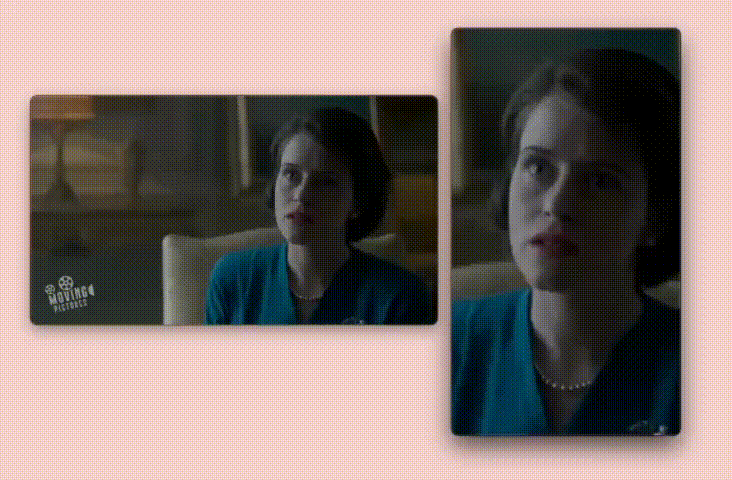

# 基于 TGTrack 的指定主体跟拍与横屏转竖屏

本项目以 [AutoCrop-Vertical](https://github.com/kamilstanuch/Autocrop-vertical) 为基础。目标是在横屏视频首帧框选一名人物或其他主体，让 9:16 裁剪窗口在同一镜头内跟随该主体，并保留原音频。

**当前状态**：原版横屏转竖屏流程已跑通。下文的主体框选、TGTrack 轨迹接口和对照实验是开发计划。

## 原版如何运行

原版用 PySceneDetect 分镜，在每个镜头的中间帧用 YOLOv8 检测人物，并通过 Haar 级联检测人脸。根据人物分布选择裁剪或加黑边。日志中的 `TRACK` 表示使用该镜头选定的裁剪区域，同一镜头内的帧共用目标框。OpenCV 处理画面，FFmpeg 编码并合并音频。

在 GitHub 原仓库点 **Fork → Create fork**，选择自己的账号作为 Owner。已有 Fork 时可以直接从自己的仓库复制 HTTPS 克隆地址。以下命令使用本仓库的地址：

```bash
git clone https://github.com/xwq23456/Autocrop-vertical.git
cd Autocrop-vertical
git remote add upstream https://github.com/kamilstanuch/Autocrop-vertical.git
git remote -v
```

`origin` 指向 Fork，用于推送自己的分支。`upstream` 指向原项目，用于获取上游更新。先安装 Git、Python 3.12 和 [FFmpeg](https://ffmpeg.org/download.html)，确保终端可以运行 `ffmpeg -version` 和 `ffprobe -version`。Python 3.12 是本次验证使用的版本。

**macOS / Linux**

```bash
python3.12 -m venv .venv
source .venv/bin/activate
python -m pip install -r requirements.txt
python main.py --help
```

**Windows PowerShell**

```powershell
py -3.12 -m venv .venv
.\.venv\Scripts\python.exe -m pip install -r requirements.txt
.\.venv\Scripts\python.exe main.py --help
```

原版可以在 CPU 上运行。在 Linux 或 Windows 上可按 [PyTorch 官方说明](https://pytorch.org/get-started/locally/) 先在虚拟环境内安装配套的 CPU 版 `torch` 和 `torchvision`，再安装仓库依赖。

选一段有音频、含明显切镜的短横屏视频，放在仓库根目录并命名为 `sample.mp4`。运行以下命令。Windows 上用 `.\.venv\Scripts\python.exe` 代替 `python`。

```bash
python main.py -i sample.mp4 -o plan-preview.mp4 --plan-only
python main.py -i sample.mp4 -o baseline-vertical.mp4 --ratio 9:16 --quality fast
ffprobe -v error -show_entries stream=codec_type,width,height,duration -of compact baseline-vertical.mp4
```

首次分析会下载 `yolov8n.pt`。第一条命令打印分镜和裁剪计划，第二条导出视频。如果出现 `No scenes were detected`，用含明显切镜的素材重新试跑。当前版本在分镜器找不到切点时可能退出。为每次试跑指定新的输出文件名，尤其是 `--plan-only`，因为原版会先删除同名输出路径上的文件。

**已验证的基线**：在 Linux、Python 3.12 和 CPU 版 PyTorch 环境中，原版将一段 4 秒、含两个镜头的 `1024×576` 测试片导出为 `324×576`，保留 96 帧和 AAC 音轨。

## 关键代码与 TGTrack 接入点

| 代码 | 当前职责 | 计划中的改动 |
| --- | --- | --- |
| [`main.py` · `detect_scenes()`](main.py#L75) | 生成镜头边界和帧号。 | 继续用于镜头切分。单镜头模式需要允许无切点的输入，例如用 `start_in_scene=True` 获取覆盖整段视频的镜头。 |
| [`main.py` · `analyze_scene_content()`](main.py#L29) 与 [`decide_cropping_strategy()`](main.py#L111) | 检测镜头代表帧上的人物，决定是否裁剪。 | 自动选人模式沿用现有逻辑。指定主体模式以首帧框选作为 TGTrack 的输入。 |
| [`main.py` · 逐帧裁剪循环](main.py#L583) 与 [`calculate_crop_box()`](main.py#L127) | 从镜头计划读取目标框，定位裁剪窗口。 | 按帧号读取 TGTrack 的目标框，将 `x,y,w,h` 转为 `x1,y1,x2,y2`，平滑裁剪窗口的横向位置并限制在画面内。 |
| [`main.py` · 音频处理](main.py#L638) | 提取并合并音频，处理流起始时间偏移。 | 复用现有编码、音频同步与合并流程。 |
| [`requirements.txt`](requirements.txt) | 定义原版的 Python 依赖。 | 原版和 TGTrack 初期使用独立环境，避免两边的 PyTorch 版本约束冲突。 |

第一版可以在 TGTrack 环境里运行单目标推理。用 `initialize()` 接收首帧选框，用 `track()` 生成后续帧的 `target_bbox`，并把帧号与目标框写入 JSON。AutoCrop 在现有环境中读取轨迹并导出竖屏视频。两边必须读取同一份预处理后的视频。可变帧率素材先转成恒定帧率，再以该视频的帧号对齐。先跑通单镜头，之后再处理丢失回退和切镜后的重新框选。 [TGTrack 推理源码](https://github.com/wtg1/TGTrack/blob/main/lib/test/tracker/tgtrack.py#L91)

## 为什么考虑 TGTrack

逐帧目标框能让裁剪窗口移动。TGTrack 值得验证的是，当选中的人转身、短暂遮挡或与另一个人交叉时，窗口能否继续跟住**同一个人**。历史目标模板提供了当前帧之外的外观线索，时间编码帮助区分模板先后。训练阶段，生成式解码器通过融合历史信息与当前模板特征来预测后续模板。这项训练监督旨在帮助模型学习目标外观随时间的变化。使用预训练权重时，项目通过逐帧目标框利用这项能力。 [TGTrack 论文](https://openaccess.thecvf.com/content/CVPR2026/html/Geng_TGTrack_Temporal_Generative_Learning_for_Unified_Single_Object_Tracking_CVPR_2026_paper.html) · [官方实现](https://github.com/wtg1/TGTrack)

当前输入为 RGB MP4 加首帧框选，所以先验证 RGB 跨帧建模。有语言选人、低光跟踪等明确需求和对应输入时，再评估语言、热红外等模态。

## 如何判断优化有效

准备两类素材。用单人横向移动验证基本跟拍，用双人交叉、转身和短时遮挡检验身份保持。保留原版成片作为产品基线，再让 TGTrack 和轻量逐帧跟踪器（如 OpenCV CSRT）使用同一素材、同一首帧框、同一裁剪比例与平滑规则。记录：

- **跟错帧数**。跟踪框落在其他主体上的帧数。
- **遮挡后恢复帧数**。从目标重新可见到正确跟踪恢复所需的帧数，同时记录未恢复的片段。
- **主体出框比例**。目标可见的帧中，目标超出裁剪窗口预定容许范围的比例。
- **处理耗时**。在同一硬件上记录跟踪耗时和端到端导出耗时。

TGTrack 在困难片段中持续减少错跟和出框，且耗时可接受时，才有依据采用它。如果目标框准确但成片仍抖动，先检查裁剪窗口的平滑参数。如果要单独归因到生成式监督，应对照同一架构在有无这项监督时训练得到的权重。

## 本地与 GitHub 分工

在本地复跑基线、调试裁剪并查看成片。运行 TGTrack 官方推理时，使用有兼容 NVIDIA GPU 的本地机器，或在云 GPU 克隆同一分支。GitHub 用于版本管理与评审。后续可以用 GitHub Actions 和固定轨迹验证竖屏尺寸、输出帧数与音轨。提交代码和文档，视频素材和大模型权重按需在本地或云存储管理。

<details>
<summary>上游英文文档</summary>

# AutoCrop-Vertical: Smart Video Cropper for Social Media



Automatically converts horizontal videos into vertical format for TikTok, Instagram Reels, and YouTube Shorts.

Instead of a static center crop, the script analyzes each scene using AI (YOLOv8), detects people, and decides whether to crop tightly on the subjects or letterbox to preserve the full shot.

---

### Quick Start

```bash
git clone https://github.com/kamilstanuch/AutoCrop-Vertical.git
cd AutoCrop-Vertical
python3 -m venv .venv
source .venv/bin/activate
pip install -r requirements.txt

python3 main.py -i video.mp4 -o vertical.mp4
```

The `yolov8n.pt` model weights are downloaded automatically on first run.

**Prerequisites:** Python 3.8+ and [FFmpeg](https://ffmpeg.org/) (`ffmpeg` + `ffprobe`) in your PATH.

---

### Usage Examples

```bash
# Basic — 9:16 vertical, balanced quality
python3 main.py -i video.mp4 -o vertical.mp4

# Instagram feed (4:5) with high quality
python3 main.py -i video.mp4 -o vertical.mp4 --ratio 4:5 --quality high

# Fast encode, square format
python3 main.py -i video.mp4 -o vertical.mp4 --ratio 1:1 --quality fast

# Preview the processing plan without encoding
python3 main.py -i video.mp4 -o vertical.mp4 --plan-only

# Full control over encoding parameters
python3 main.py -i video.mp4 -o vertical.mp4 --crf 20 --preset medium

# Use hardware encoder (macOS VideoToolbox / NVIDIA NVENC)
python3 main.py -i video.mp4 -o vertical.mp4 --encoder hw

# Maximum accuracy scene detection (slower)
python3 main.py -i video.mp4 -o vertical.mp4 --frame-skip 0
```

---

### All Flags

**Output:**

| Flag | Default | Description |
|------|---------|-------------|
| `-i`, `--input` | *(required)* | Path to input video |
| `-o`, `--output` | *(required)* | Path to output video (`.mp4` appended if no extension) |
| `--ratio` | `9:16` | Output aspect ratio. Examples: `9:16`, `4:5`, `1:1` |

**Encoding quality:**

| Flag | Default | Description |
|------|---------|-------------|
| `--quality` | `balanced` | Preset: `fast`, `balanced`, or `high` (see table below) |
| `--encoder` | `auto` | `auto` = libx264 (software), `hw` = hardware if available, or explicit name like `h264_videotoolbox` |
| `--crf` | *(from quality)* | Override CRF directly, 0-51 lower = better (libx264 only) |
| `--preset` | *(from quality)* | Override x264 preset directly: `ultrafast`..`veryslow` (libx264 only) |

**Quality presets (libx264):**

| `--quality` | CRF | Preset | Typical use |
|-------------|-----|--------|-------------|
| `fast` | 28 | veryfast | Quick previews, drafts |
| `balanced` | 23 | fast | Good quality, reasonable speed |
| `high` | 18 | slow | Best quality, largest file, slowest |

**Scene detection tuning:**

| Flag | Default | Description |
|------|---------|-------------|
| `--frame-skip` | `0` | Frames to skip during scene detection. `0` = every frame (most accurate). `1` = every other frame (~2x faster). Higher = faster but may miss cuts |
| `--downscale` | `0` (auto) | Downscale factor for scene detection. `0` = auto. `2`-`4` = faster but may miss subtle cuts |

**Other:**

| Flag | Default | Description |
|------|---------|-------------|
| `--plan-only` | off | Run scene detection + analysis only, print the plan, exit without encoding |

---

### Key Features

*   **Content-Aware Cropping:** YOLOv8 detects people and centers the vertical frame on them.
*   **Automatic Letterboxing:** When people are too spread out for a vertical crop, black bars are added to preserve the full shot.
*   **Scene-by-Scene Processing:** Decisions are made per scene for consistent, logical edits.
*   **Native Resolution:** Output height matches the source to prevent quality loss from upscaling.
*   **Frame-Accurate Processing:** Every frame is processed individually with the correct per-scene strategy — no timestamp rounding or scene boundary drift.
*   **Hardware Encoder Support:** Optional `--encoder hw` auto-detects VideoToolbox (macOS) or NVENC (NVIDIA) with automatic fallback to libx264.
*   **VFR Handling:** Variable frame rate sources are automatically normalized before processing.
*   **Audio Sync:** Non-zero stream start times are detected and compensated to keep audio/video aligned.

---

### How It Works

```
Input Video
    |
    v
+-------------------------------+
| 1. Scene Detection            |  PySceneDetect splits the video into scenes
|    (--frame-skip, --downscale)|
+---------------+---------------+
                |
                v
+-------------------------------+
| 2. Content Analysis           |  YOLOv8 detects people in each scene's
|    (middle frame per scene)   |  middle frame; Haar cascade finds faces
+---------------+---------------+
                |
                v
+-------------------------------+
| 3. Strategy Decision          |  Per scene: TRACK (crop on subject)
|                               |  or LETTERBOX (scale + black bars)
+---------------+---------------+
                |
                v
+-------------------------------+
| 4. Frame Processing           |  Per-frame crop/scale/pad via OpenCV
|    (--quality, --encoder)     |  piped to FFmpeg for encoding
+---------------+---------------+
                |
                v
+-------------------------------+
| 5-6. Audio extract + merge    |  Audio synced with start-time offset
+---------------+---------------+
                |
                v
          Output Video
```

Steps 1-3 are the "planning" phase (Python + AI). Step 4 applies the plan frame-by-frame and encodes via FFmpeg.

---

### Performance

Benchmarks on Apple M1 MacBook Pro (AC power):

| Resolution | Duration | Total time | Speed |
|-----------|----------|-----------|-------|
| 1280x720 | 49s | ~6s | 8.3x real-time |
| 1920x1080 | 12 min | ~51s | 13.7x real-time |

Scene detection is the dominant bottleneck (~50% of total time).

---

### Technical Details

This script is built on a pipeline that uses specialized libraries for each step:

*   **Core Libraries:**
    *   `PySceneDetect`: For accurate, content-aware scene cut detection.
    *   `Ultralytics (YOLOv8)`: For fast and reliable person detection.
    *   `OpenCV`: Used for frame manipulation, face detection (as a fallback), and reading video properties.
    *   `FFmpeg` / `ffprobe`: The backbone of video encoding, audio extraction, and media stream analysis.
    *   `tqdm`: For clean and informative progress bars in the console.

*   **Processing Pipeline:**
    1.  **(Pre-processing)** If the source is VFR, it is normalized to constant frame rate.
    2.  `PySceneDetect` scans the video and returns a list of scene timestamps.
    3.  For each scene, `OpenCV` extracts a sample frame and `YOLOv8` detects people in it.
    4.  A set of rules determines the strategy (`TRACK` or `LETTERBOX`) for each scene based on the number and position of detected people.
    5.  OpenCV reads every frame sequentially. Each frame is cropped/resized (TRACK) or scaled/padded (LETTERBOX) according to its scene's strategy, then piped as raw pixels to FFmpeg for encoding. This frame-by-frame approach guarantees frame-accurate scene boundaries with no timestamp rounding errors.
    6.  Audio is extracted separately (with start-time offset correction), then merged with the processed video.

---

### Changelog

#### v1.4.1 (2026-02-15) — Cropping Accuracy Fix

*   **Fixed incorrect crop/letterbox decisions near scene boundaries.** The v1.3 `filter_complex` pipeline used seconds-based `trim` filters, which caused floating-point misalignment with the frame-based scene boundaries from PySceneDetect. This led to frames at scene transitions receiving the wrong strategy (e.g., a properly tracked person switching to letterbox mid-scene, or a group shot being cropped instead of letterboxed). Restored the original frame-by-frame processing pipeline which uses exact frame numbers for scene boundary matching, guaranteeing frame-accurate results.

#### v1.4.0 (2026-02-15) — Hardware Encoding & Scene Detection Tuning

**New Features:**

*   **Hardware encoder support (`--encoder`).** New flag with three modes: `auto` (libx264, default for best quality/compatibility), `hw` (auto-detect VideoToolbox on macOS or NVENC on NVIDIA), or an explicit encoder name. Quality presets (`--quality`) map automatically per encoder type.
*   **Configurable scene detection (`--frame-skip`, `--downscale`).** Power users can tune the speed/accuracy trade-off. Default `--frame-skip 0` processes every frame for maximum accuracy; increase for faster detection on longer videos.

#### v1.3.0 (2026-02-15) — Configurable Output & Quality Presets

**New Features:**

*   **Configurable aspect ratio (`--ratio`).** Output is no longer locked to 9:16. Use `--ratio 4:5` for Instagram feed, `--ratio 1:1` for square, or any custom W:H ratio.
*   **Quality presets (`--quality`).** Choose between `fast` (CRF 28, veryfast), `balanced` (CRF 23, fast — default), or `high` (CRF 18, slow). Power users can override directly with `--crf` and `--preset`.
*   **Dry-run mode (`--plan-only`).** Runs scene detection and analysis only, prints the processing plan, and exits without encoding. Useful for previewing decisions before committing to a long encode.
*   **Fixed output pixel format.** Encoder now outputs `yuv420p` instead of `yuv444p`, which is compatible with all players and platforms and produces smaller files.
*   **Improved logging and progress reporting.** Input file summary upfront (resolution, duration, fps, codec, file size, frame count), progress bars on all slow operations, and a final summary with output size, compression ratio, and processing speed.

#### v1.1.0 (2026-02-14)

**Bug Fixes:**

*   **Fixed audio/video desynchronization.** This was caused by two separate issues:
    *   The frame rate was being read from PySceneDetect while frames were read by OpenCV. A mismatch between the two (e.g. 29.97 vs 30.0) caused the encoded video duration to drift from the audio. FPS is now read from OpenCV (the same backend that reads the frames) with explicit `-vsync cfr` enforcement.
    *   Many source files (especially YouTube downloads) have a non-zero `start_time` on the video stream (e.g. audio at 0.0s, video at 1.8s). The script now detects this offset via `ffprobe` and trims the extracted audio to match, so the two streams stay aligned.
*   **Fixed crash on videos without an audio stream.** The script now detects whether audio exists using `ffprobe` and skips the audio extraction/merge steps gracefully.
*   **Fixed hardcoded `.aac` temp audio file.** The temp audio container is now `.mkv`, which accepts any audio codec. Previously, source files with non-AAC audio (MP3, Opus, AC3, etc.) could fail or produce corrupt output.
*   **Fixed crash when output path has no file extension.** The script now auto-appends `.mp4` if no extension is provided.
*   **Fixed orphaned temp files on failure.** Temporary files are now cleaned up on all exit paths, not just on success.

**Improvements:**

*   **Variable frame rate (VFR) handling.** Phone-recorded videos often use VFR, which caused frame timing drift. The script now detects VFR sources via `ffprobe` and normalizes them to constant frame rate before processing.
*   **Corrupt frame resilience.** If a frame fails to process (bad crop, corrupt data), it is duplicated from the previous good frame instead of being dropped. This preserves the total frame count and prevents audio drift.
*   **Lazy model loading.** YOLO and Haar cascade models are now loaded on first use instead of at import time. Heavy library imports (`torch`, `ultralytics`, `cv2`, etc.) are deferred until after argument parsing, so `--help` is instant.
*   **Pinned dependency versions.** `requirements.txt` now specifies compatible version ranges to prevent breakage from upstream changes.
*   **Replaced `exit()` with `sys.exit(1)`.** Ensures proper exit codes and reliable behavior in all environments.

</details>
